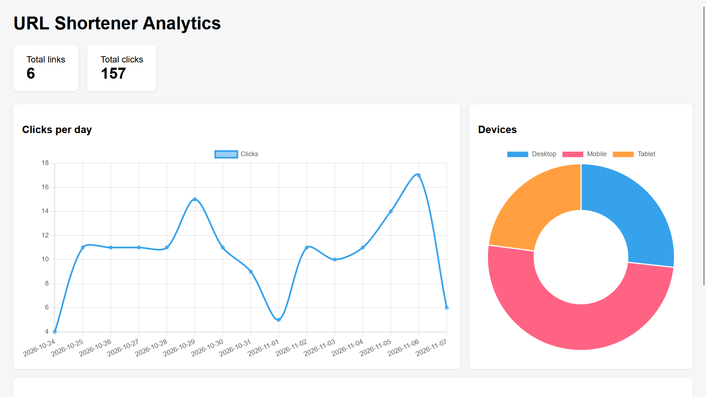
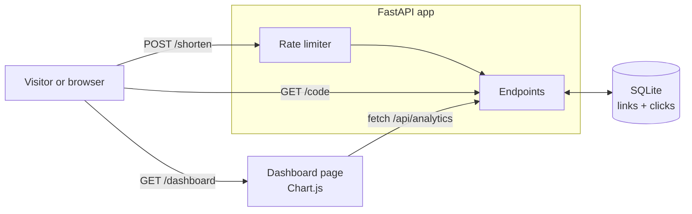
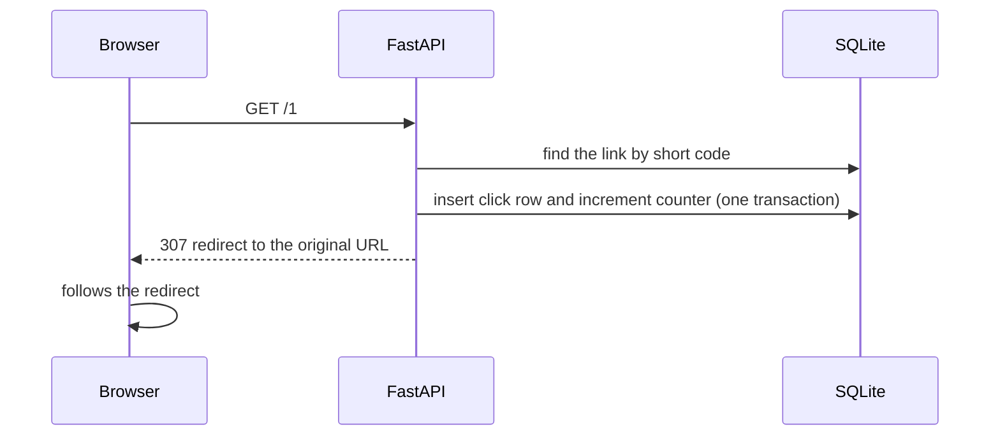
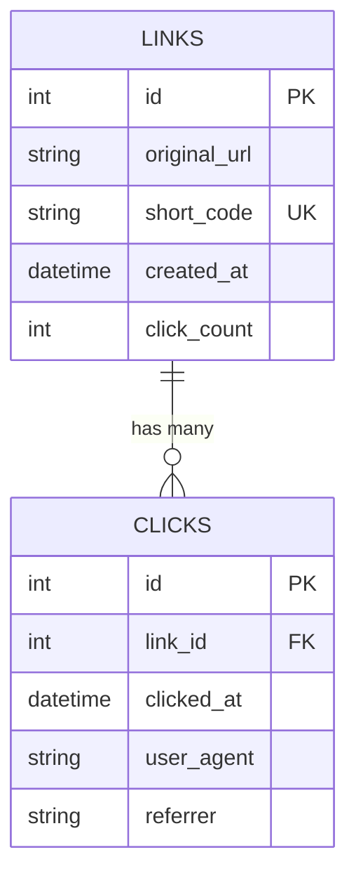

# url-shortener-analytics
# URL Shortener with Analytics

A URL shortener built with **FastAPI** that records every click and turns the data into a live analytics dashboard. It was load-tested under concurrent traffic, packaged with Docker and deployed online.

**Live demo:** `https://url-shortener-analytics-mtq5.onrender.com/`
Dashboard: `https://url-shortener-analytics-mtq5.onrender.com/dashboard` | API docs: `https://url-shortener-analytics-mtq5.onrender.com/docs`

> The demo runs on a free host. The first request after a quiet period can take up to a minute (cold start), and stored data may be reset when the service restarts.


*Dashboard shown with demo data generated by `seed.py`.*

---

## Table of contents
1. [Features](#features)
2. [Tech stack](#tech-stack)
3. [How it works](#how-it-works)
4. [API reference](#api-reference)
5. [Getting started](#getting-started)
6. [Configuration](#configuration)
7. [Testing](#testing)
8. [Performance and load testing](#performance-and-load-testing)
9. [Deployment](#deployment)
10. [Design decisions](#design-decisions)
11. [Known limitations and future work](#known-limitations-and-future-work)
12. [Project structure](#project-structure)

---

## Features
- **Shorten** any `http` or `https` URL into a short base62 code
- **Redirect** with click tracking: time, browser/device type and referrer
- **Per-link stats**: total clicks and the 10 most recent clicks
- **Analytics dashboard**: clicks per day, device split and top links
- **Input validation**: invalid URLs are rejected before they reach the database
- **Duplicate handling**: shortening the same URL twice returns the same code
- **Rate limiting**: 10 requests per minute per client on `/shorten`
- **Automated tests**: 10 pytest tests, each on a fresh in-memory database
- **Docker image** and a live deployment

## Tech stack

| Area | Tools |
|---|---|
| Backend | Python, FastAPI, Uvicorn |
| Database | SQLite (WAL mode), SQLAlchemy |
| Validation | Pydantic |
| Rate limiting | SlowAPI |
| Dashboard | HTML, JavaScript, Chart.js |
| Testing | pytest, httpx |
| Packaging and hosting | Docker, Render |

Developed and tested on Python <Python 3.14.1>.

## How it works



**Shortening a URL.** The URL is validated and saved. The database assigns the row an integer id, and the id is converted to a base62 string (`0-9`, `a-z`, `A-Z`). Ids are unique, so short codes are unique without any collision checks. For example, id `125` becomes `21`, and id `1,000,000` becomes `4c92`.

**Following a short link.**



**Data model.** One link has many clicks. Keeping one row per click (not just a counter) is what makes analytics by day, device and referrer possible.



## API reference

| Method | Path | Purpose |
|---|---|---|
| POST | `/shorten` | Create a short link (rate limited) |
| GET | `/{code}` | Redirect to the original URL and log the click |
| GET | `/stats/{code}` | Total clicks and the 10 most recent clicks |
| GET | `/api/analytics` | Summary data used by the dashboard |
| GET | `/dashboard` | Analytics dashboard page |
| GET | `/docs` | Interactive API documentation (Swagger UI) |

**Create a short link**
```
POST /shorten
{"url": "https://www.google.com"}
```
```json
{"short_code": "1", "original_url": "https://www.google.com/"}
```
Notes: bare domains are normalised with a trailing `/`. Invalid input returns `422`. More than 10 requests per minute from one client returns `429`.

**Link stats**
```
GET /stats/1
```
```json
{
  "short_code": "1",
  "original_url": "https://www.google.com/",
  "click_count": 3,
  "created_at": "2026-11-07T10:15:00",
  "recent_clicks": [
    {"clicked_at": "2026-11-07T10:20:00", "user_agent": "Mozilla/5.0 ...", "referrer": null}
  ]
}
```
Unknown codes return `404`. Times are stored in UTC.

**Analytics summary**
```
GET /api/analytics
```
```json
{
  "total_links": 5,
  "total_clicks": 213,
  "clicks_per_day": {"2026-11-06": 80, "2026-11-07": 133},
  "devices": {"Desktop": 90, "Mobile": 100, "Tablet": 23},
  "top_links": [{"short_code": "2", "url": "https://github.com/", "clicks": 58}]
}
```

## Getting started

### Run locally

Windows (PowerShell):
```powershell
git clone https://github.com/laptop270825/url-shortener-analytics.git
cd url-shortener-analytics
python -m venv venv
venv\Scripts\activate
pip install -r requirements.txt
uvicorn app.main:app --reload
```

macOS / Linux:
```bash
git clone https://github.com/laptop270825/url-shortener-analytics.git
cd url-shortener-analytics
python -m venv venv
source venv/bin/activate
pip install -r requirements.txt
uvicorn app.main:app --reload
```

Then open:
- http://127.0.0.1:8000/docs to try the API
- http://127.0.0.1:8000/dashboard for the dashboard

Optional demo data (fake links and clicks so the charts have something to show):
```
python seed.py
```

### Run with Docker
```
docker build -t url-shortener .
docker run -p 8000:8000 url-shortener
```
A container's files disappear when it is removed. To keep the database between runs, attach a volume:
```
docker run -p 8000:8000 -v shortener-data:/data -e DATABASE_URL=sqlite:////data/shortener.db url-shortener
```

## Configuration

| Variable | Default | Purpose |
|---|---|---|
| `DATABASE_URL` | `sqlite:///./shortener.db` | Database location |
| `PORT` | `8000` | Port the container listens on (hosting platforms set this) |

## Testing
```
pytest -v
```
The 10 tests cover shortening, URL validation, duplicate handling, redirects, unknown codes (404), click statistics, the analytics summary, device detection and rate limiting. Each test runs against a fresh in-memory database, so the real database is never touched.

## Performance and load testing

`benchmark.py` sends 2,000 requests per endpoint with 20 concurrent clients and reports throughput, median latency, 95th-percentile latency and errors. For the redirect endpoint it also checks that the number of stored clicks equals the number of successful requests.

**Test setup:** Intel Ultra 7 and 16GB RAM, Windows 11, Python 3.14.1, one Uvicorn worker, SQLite in WAL mode, a separate benchmark database. The load generator ran on the same machine as the server, so both compete for the same CPU. Figures come from a single run and vary by a few percent between runs.

| Endpoint | Requests/sec | Median | p95 | Errors |
|---|---|---|---|---|
| `GET /{code}` (redirect + click log) | 390 | 13.5 ms | 65.6 ms | 0 |
| `GET /stats/{code}` | 494 | 39.1 ms | 53.8 ms | 0 |
| `GET /api/analytics` | 324 | 60.9 ms | 78.9 ms | 0 |

All 2,000 clicks were counted correctly under concurrent load.

**What the load test found, and what changed**

1. **Concurrent redirects failed with `sqlite3.OperationalError: database is locked`.** SQLite allows one writer at a time, and every redirect writes a click row. Three changes together resolved it: WAL mode, a 30-second busy timeout, and replacing `click_count += 1` (read, add, write back, which can lose updates under concurrency) with an atomic SQL `UPDATE ... SET click_count = click_count + 1`. They were applied together, so the individual contribution of each was not measured.
2. **`/api/analytics` was slow.** It loaded every click into Python and counted in a loop: 15 requests/sec and a 1,302 ms median. Moving the counting into SQL (`GROUP BY`) raised it to 324 requests/sec and a 60.9 ms median, about 21x faster on this dataset (one link, one day).

**Reproduce it**

Use a separate database so test traffic never touches real data. Do not use `--reload` while benchmarking.

PowerShell:
```powershell
$env:DATABASE_URL = "sqlite:///./bench.db"
uvicorn app.main:app
```
macOS / Linux:
```bash
DATABASE_URL=sqlite:///./bench.db uvicorn app.main:app
```
Then, in a second terminal with the virtual environment active:
```
python benchmark.py
```
`/shorten` is not benchmarked because the rate limiter intentionally blocks it after 10 requests per minute.

## Deployment
The app runs as a Docker container on Render (free web service, Docker runtime, auto-deploy on every push to `main`).
- The container listens on `0.0.0.0` and reads the port from `PORT`.
- Uvicorn runs with `--proxy-headers`, so the rate limiter sees each visitor's real IP address behind the host's proxy.
- The database path comes from `DATABASE_URL`, so the same image can use different storage.

## Design decisions

| Decision | Reason |
|---|---|
| Base62 of the database id | Unique by construction, no collision checks, short codes stay short |
| `307` (temporary) redirect | Browsers don't cache it, so every click reaches the server and is counted |
| One row per click | Enables analytics by day, device and referrer, not just a total |
| Click row and counter in one transaction | Both are saved or neither is, so the numbers cannot disagree |
| Atomic SQL counter update | Prevents lost updates under concurrent requests |
| Aggregation in SQL | The database returns a few summary rows instead of every click |
| WAL mode with a busy timeout | Reads and writes overlap, and writers wait for their turn instead of failing |
| `synchronous=NORMAL` | Faster writes, at the cost of possibly losing the last few writes on a power failure, which is acceptable here |
| Models separate from schemas | What is stored and what is returned are different shapes |
| Database URL from the environment | One image, different storage |
| `textContent` in the dashboard | User-submitted URLs are displayed as plain text, never as HTML |

## Known limitations and future work
- **Predictable codes.** Sequential ids make short codes guessable. Scrambling the id (for example, with a keyed permutation) would fix that.
- **Single writer.** SQLite allows one writer at a time, which limits write concurrency (the redirect's p95 of about 65 ms reflects writers queuing). PostgreSQL would scale better, and the `DATABASE_URL` setting makes switching straightforward.
- **Analytics still scans all click rows.** Pre-aggregated daily totals would scale to much larger data. An index on `(link_id, clicked_at)` would likely speed up `/stats`.
- **Keyword-based device detection.** A user-agent parsing library would be more accurate.
- **No authentication.** Anyone can create links and see the dashboard.
- **Abuse.** There is no check against malicious destinations, so a public shortener could be used for phishing. A blocklist or URL-reputation check would be needed in production.
- **Free hosting.** Storage is temporary and the service sleeps when idle.
- **Container runs as root.** A non-root user would be safer.
- **Rate limiting is per IP.** Visitors behind one shared IP share a limit.
- **Benchmark scope.** Single run, one machine, simple data. The figures show relative improvements, not production capacity.

## Project structure
```
.
├── app/
│   ├── main.py          endpoints and app setup
│   ├── database.py      database connection, WAL settings, session
│   ├── models.py        Link and Click tables
│   ├── schemas.py       request and response shapes
│   ├── utils.py         base62 encoding, device detection
│   └── static/
│       └── dashboard.html
├── tests/
│   ├── conftest.py      in-memory database fixture
│   └── test_api.py
├── docs/images/         README screenshots
├── seed.py              demo data generator
├── benchmark.py         load test
├── Dockerfile
├── .dockerignore
├── pytest.ini
└── requirements.txt
```